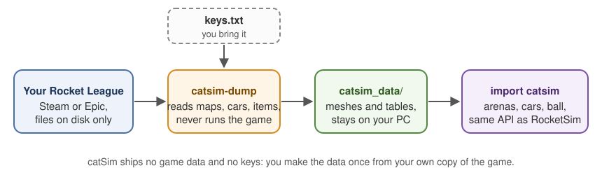

# catSim

A Rocket League physics simulator that aims to match the real game **bit for bit**, with a Python API shaped
like RocketSim's, so most RocketSim scripts run with one changed import.



> **Status: first release (0.1.0).** Soccar on Stadium_P and UF_Night_P at 120 ticks a second. The dumper is tested
> on Steam installs; the Epic Games edition is supported but **not yet tested on a real Epic install**. On PyPI as
> [`catsim-rl`](https://pypi.org/project/catsim-rl/) (the name `catsim` there is an unrelated project).

## Five minutes to a first simulation

**1. Install** (Windows or Linux, 64-bit, Python 3.10 or newer):

```
pip install "catsim-rl[dump]"       # imports as `catsim`; [dump] adds cryptography, which the dumper uses to decrypt fast
```

**2. Get the key file.** Rocket League's package files are encrypted, and catSim includes no keys. The community
tools that open Rocket League's `.upk` packages (the UPK decryptors and asset tools modders use) come with a
`keys.txt`: one key per line. If you have one of those tools, you already have the file. catSim never downloads
keys.

**3. Make the game data** from your own copy of Rocket League (Steam or Epic):

```
catsim-dump --out catsim_data --keys path/to/keys.txt
```

It finds the game by itself, checks the version and writes `catsim_data/` (about three minutes, most of it
reading the car items; add `--skip-items` for a ten-second dump without them). It only reads files: it never
starts the game and never touches a running one. More in [docs/DUMPER.md](docs/DUMPER.md).

**4. Simulate:**

```python
import catsim as rs

rs.init("catsim_data")
arena = rs.Arena(rs.GameMode.SOCCAR)
car = arena.add_car(rs.Team.BLUE, rs.CarConfig(rs.CarConfig.OCTANE))
car.set_controls(rs.CarControls(throttle=1.0, boost=True))

arena.step(120)                      # one second: the game runs 120 ticks a second
print(car.get_state().pos)           # where the car is now
print(arena.ball.get_state().pos)    # and the ball
```

That's it. If you already use RocketSim, write `import catsim as rs` in place of `import RocketSim as rs` and
point `init` at `catsim_data` instead of `collision_meshes`.

## What you get

- **Arenas, cars and the ball** with get and set state, controls, kickoff resets, goal, bump and ball-touch
  callbacks, boost pads, every car body and hitbox preset, and ball prediction. Two maps' layouts: Stadium_P
  (the standard soccar arena) and UF_Night_P. See [docs/API.md](docs/API.md), which also lists every difference
  from RocketSim.
- **The game's own frame loop and random numbers**, for replaying real games: frames with their real duration,
  and a model of everything that draws from the game's random-number stream (animated car parts and map parts,
  effects, the camera), so kickoff spawn choices come out as in the game. It reads which parts your cars' items
  add from your own copy of the game.
- **Two engines held together by a proof.** A plain scalar engine that is easy to read, and a fast one that is
  checked bit for bit against it by differential fuzzing (`engine/proof`).
- **A game-data dumper** for the Steam and Epic editions, on Windows and Linux.

## How accurate is it?

Only what has been measured is claimed; [docs/ACCURACY.md](docs/ACCURACY.md) has the numbers and how to check
them. In short: the dumper's data equals the development engine's (with two values corrected to the game's
own), the fast engine equals the reference engine bit for bit, Windows and Linux agree bit for bit, and one of
our own recorded 2v2 games (five minutes, not published) replays through this engine with every compared tick
exact.

## Building from source

You need Rust 1.95 and Python 3.10+.

```
python tools/build_wheel.py          # builds engine/python and packs dist/catsim_rl-*.whl
pip install dist/catsim_rl-*.whl
python -m pytest tests               # set CATSIM_DATA=catsim_data for the API tests
```

The engine's own proof: `cargo run --release -p catsim_proof --bin catsim_fuzz -- catsim_data/soccar 100000 4 1`
(from `engine/`).

## Credits

- The Python API mirrors **RocketSim** (ZealanL/RocketSim) and its Python bindings: class names, method names
  and state fields follow theirs so existing code keeps working. catSim's engine is separate code.
- The physics layer follows the algorithms of the **Bullet** physics library (zlib licence), which the game
  itself uses.
- The community's Rocket League package tools, whose key file the dumper reads.
- [docs/PROVENANCE.md](docs/PROVENANCE.md) says where every piece of catSim comes from.

## License

MIT, copyright adventure-gpt. See [LICENSE](LICENSE).
