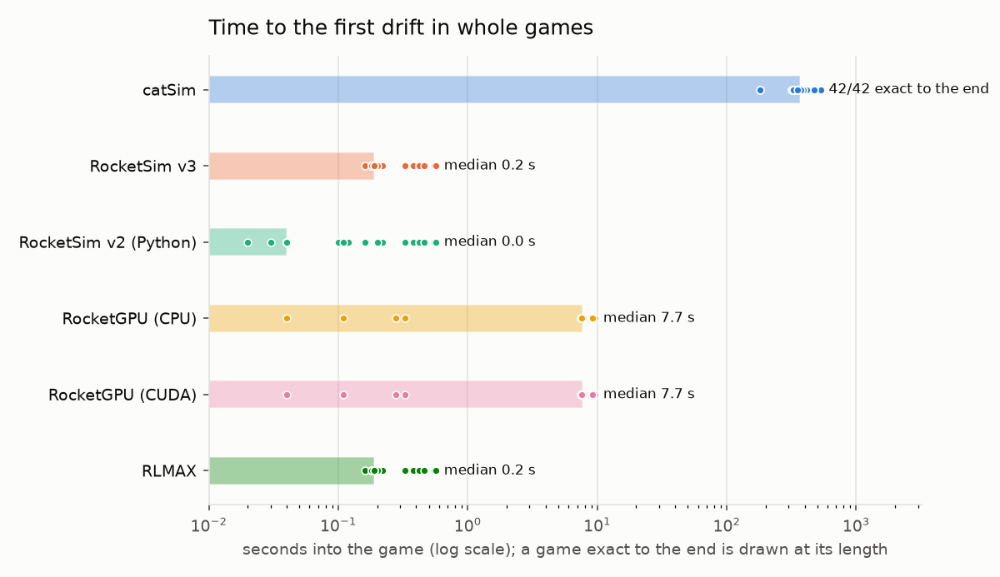
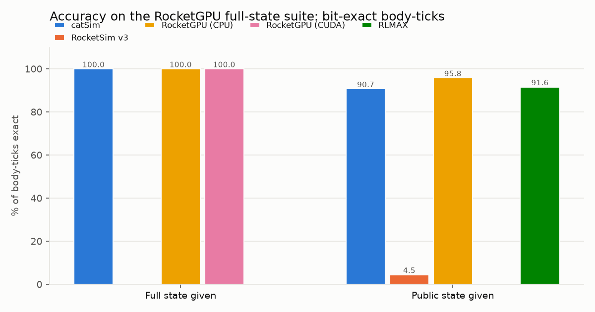
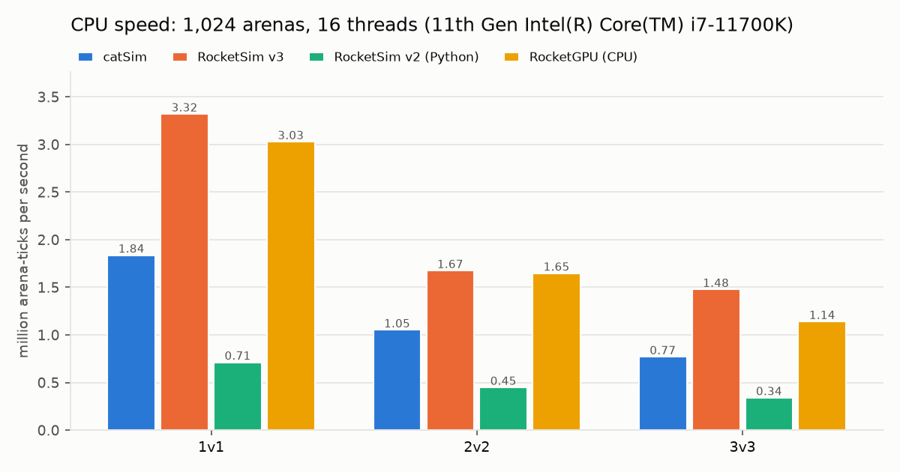
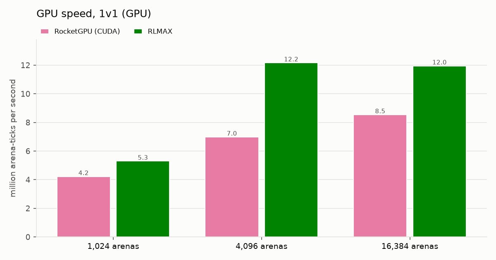
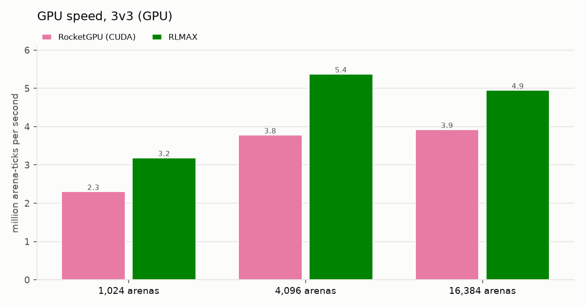

# Benchmarks: catSim beside the other Rocket League simulators

One harness, any simulator. `bench/simbench` runs the same benchmarks on catSim, RocketSim v3, RocketSim v2,
RocketGPU, RLMAX and any simulator someone writes an adapter for, on your own machine. It writes the result itself:
`bench_results/report.md`, a `report.html` you can open in a browser, and the charts. The tables below are that same
generated report, filled in by `python -m simbench report --doc ../docs/BENCHMARKS.md`. Every number says what the
simulator was given and what was scored. Every simulator that was run gets a column, and "not supported" says why.

<!-- simbench:summary (generated by python -m simbench report; edit report.py, not this) -->

The same tests for every simulator, on one machine: Intel Core i7-11700K (16 threads), NVIDIA RTX 5070 Ti, 2026-11-07.

## Accuracy

| test | catSim | RocketGPU (CPU) | RocketGPU (CUDA) | RocketSim v3 | RocketSim v2 | RLMAX |
|---|---|---|---|---|---|---|
| **Whole games: the simulator runs each match from the first kickoff to the end** | | | | | | |
| Kickoff and respawn spots given<br><sub>42 recorded matches, compared at packet precision</sub> | **42 / 42** exact to the end | **0 / 42** first drift after 7.7 s (median) | **0 / 42** first drift after 7.7 s (median) | **0 / 42** first drift after 0.2 s (median) | **0 / 42** first drift after 0.0 s (median) | **0 / 42** first drift after 0.2 s (median) |
| Only the random stream's initial state given<br><sub>7 recorded matches; the simulator picks every spot itself</sub> | **6 / 7** 1 match drifts, the first at 154.4 s | **—** doesn't model the game's random stream | **—** doesn't model the game's random stream | **—** doesn't model the game's random stream | **—** doesn't model the game's random stream | **—** doesn't model the game's random stream |
| At float precision, spots given<br><sub>7 captured matches, every body's internal floats after every frame</sub> | **6 / 7** 1 of 287,409 float rows off | **0 / 7** 59.02% of float rows exact | **0 / 7** 59.02% of float rows exact | **0 / 7** 0.01% of float rows exact | **0 / 7** 0.01% of float rows exact | **0 / 7** 4.00% of float rows exact |
| At float precision, only the random stream's initial state given<br><sub>7 captured matches, internal floats</sub> | **5 / 7** 91.97% of float rows exact | **—** doesn't model the game's random stream | **—** doesn't model the game's random stream | **—** doesn't model the game's random stream | **—** doesn't model the game's random stream | **—** doesn't model the game's random stream |
| **Segments: the RocketGPU full-state suite (v2), 26,378 segments of up to 120 ticks, 14.7M body-ticks** | | | | | | |
| Started from the game's full internal state<br><sub>physics only: nothing to guess</sub> | **100%** of body-ticks exact | **100%** of body-ticks exact | **100%** of body-ticks exact; the test split only: 10 of 144 recordings, 1.6M of 14.7M body-ticks | **—** can't load the full state | **—** can't load the full state | **—** can't load the full state |
| Started from the public state<br><sub>what a packet shows + RocketSim v3's timers; the rest is guessed</sub> | **90.73%** 92.82% within tolerance | **95.84%** 96.36% within tolerance | *not run* | **4.47%** 86.31% within tolerance | **—** can't take this start state | **91.63%** 96.69% within tolerance; scored on 14.2M of 14.7M body-ticks (753 segments it couldn't run) |
| Started from packet fields only<br><sub>only what an RLBot packet lists</sub> | **74.32%** 67.06% within tolerance | **78.34%** 69.52% within tolerance | *not run* | **3.07%** 64.22% within tolerance | **—** can't take this start state | **76.15%** 77.14% within tolerance; scored on 14.2M of 14.7M body-ticks (753 segments it couldn't run) |
| RocketSim's own replay test<br><sub>rlpr_metric, unchanged; 120-tick segments</sub> | **97.46%** of car-ticks within tolerance; mean error 1.25 | **—** its adapter can't take an RLPR tick record | **—** its adapter can't take an RLPR tick record | **97.76%** of car-ticks within tolerance; mean error 0.63 | **—** its adapter can't take an RLPR tick record | **—** its adapter can't take an RLPR tick record |

- catSim's whole games run through catSim (Python), its binding that runs whole matches.
- Whole games for RocketGPU (CPU), RocketGPU (CUDA), RocketSim v3, RocketSim v2 and RLMAX: the harness supplies the match flow each lacks. The first kickoff's cars are born as the game makes them (the recording's restart through catSim's spawn rules from the dump; the simulator runs the drop), each later kickoff starts where the packet shows it, and the harness holds the cars through each countdown, restarts after goals and puts respawned cars on the recording's spots. Each kickoff and respawn puts a new car there with the game's spawn boost, 33.3. At float precision the bodies are set to the game's own floats at the first float row and at each later kickoff's start. Each runs its own physics, pads, boost and demolitions; scored on bodies only.

**Exact**: Position, velocity, spin and rotation bit-for-bit equal to the game's.  
**Within tolerance**: Off by less than about 2 units of position or 3 units/s of speed (the RocketGPU full-state suite's own measure: under 1 on its normalized error).  
**First drift**: The time into a match until the simulator first differs from the game.  
**—**: The simulator can't run this test; the reason is under the dash.  

## Speed

**CPU · 1,024 arenas of 1v1 · 16 threads** (arena-ticks per second)

| simulator | arena-ticks/s | of the fastest |
|---|---:|---:|
| RocketSim v3 | 3.32M | 100% |
| RocketGPU (CPU) | 3.03M | 91% |
| catSim | 1.84M | 55% |
| RocketSim v2 | 713k | 21% |

**CPU · 1,024 arenas of 3v3 · 16 threads** (arena-ticks per second)

| simulator | arena-ticks/s | of the fastest |
|---|---:|---:|
| RocketSim v3 | 1.48M | 100% |
| RocketGPU (CPU) | 1.14M | 77% |
| catSim | 770k | 52% |
| RocketSim v2 | 341k | 23% |

**GPU · 16,384 arenas · RTX 5070 Ti** (arena-ticks per second)

| simulator | arena-ticks/s | of the fastest |
|---|---:|---:|
| RLMAX · 1v1 | 11.95M | 100% |
| RocketGPU (CUDA) · 1v1 | 8.54M | 71% |
| RLMAX · 2v2 | 7.11M | 59% |
| RocketGPU (CUDA) · 2v2 | 5.19M | 43% |
| RLMAX · 3v3 | 4.95M | 41% |
| RocketGPU (CUDA) · 3v3 | 3.92M | 33% |

Some timed rounds ran while other processes were busy; the speed details below name them.

<picture><source media="(prefers-color-scheme: dark)" srcset="bench/drift_dark.png"></picture>

<picture><source media="(prefers-color-scheme: dark)" srcset="bench/accuracy_dark.png"></picture>

<picture><source media="(prefers-color-scheme: dark)" srcset="bench/speed_cpu_dark.png"></picture>

<picture><source media="(prefers-color-scheme: dark)" srcset="bench/speed_gpu_1v1_dark.png"></picture>

<picture><source media="(prefers-color-scheme: dark)" srcset="bench/speed_gpu_3v3_dark.png"></picture>


Machine:

- 11th Gen Intel(R) Core(TM) i7-11700K @ 3.60GHz, 16 threads, 19.5 GB RAM, Linux 6.18.54.1-microsoft-standard-WSL2 (recordings, rlpr, speed, suite). WSL2 on Windows: load from Windows processes is not measured
- 11th Gen Intel(R) Core(TM) i7-11700K @ 3.60GHz, 16 threads, 19.5 GB RAM, Linux 6.18.54.1-microsoft-standard-WSL2; NVIDIA GeForce RTX 5070 Ti, 16303 MiB, 617.14 (recordings, rlpr, speed, suite). WSL2 on Windows: load from Windows processes is not measured

<!-- /simbench:summary -->

## Run it yourself

You need Python 3.10 or newer with numpy, the game data from catSim's dumper, and Rust (rustup.rs) for the native
workers. The commands below fetch or build everything else; nothing is installed system-wide.

```
pip install "catsim-rl[dump]" numpy matplotlib          # catSim, its dumper; matplotlib draws the charts
catsim-dump --out catsim_data --keys path/to/keys.txt     # your own copy of the game's data (README, step 2-3)
cd bench
python -m simbench all --sims catsim,catsim-py,rocketsim-v3 --data ../catsim_data --suite-data PATH
```

Every command ends by writing `bench_results/report.md`, `report.html` and the charts, and by printing the
at-a-glance lines and the summary table. `python -m simbench report` rebuilds them from
`bench_results/results.jsonl` at any time.

RocketSim and the others read RocketSim's arena meshes. The harness makes them from catSim's dump, byte for byte the
files RocketSim's own dumper writes (`python -m simbench.meshes` checks their SHA-256), so one dump serves every
simulator. The numbers here use the dump of Steam build 26349479, which holds the same data as build 25914621's.

| Benchmark | Command (from `bench/`) | Takes | Download first |
|---|---|---|---|
| Whole games | `python -m simbench recordings --sims catsim-py,rocketsim-v3` | 1-10 min per simulator | our recordings (one is in git; the rest from the release, below) |
| The RocketGPU full-state suite (full state, public state, packet fields) | `python -m simbench suite --sims catsim,rocketsim-v3 --suite-data PATH` | 5-15 min per simulator and start | the suite's recordings (863 MB, below) |
| RocketSim's own replay test | `python -m simbench rlpr --sims catsim,rocketsim-v3` | 5 min to build, 2 min per simulator | nothing (RocketSim is fetched at its pinned release, 700 MB) |
| Speed (CPU and GPU tables) | `python -m simbench speed --sims catsim,rocketsim-v3` | 15-25 min (`--plan quick`: 3 min) | nothing |
| Everything | `python -m simbench all --sims ... --suite-data PATH` | about an hour | both |
| Test a new adapter | `python -m simbench check --sims mine=my_adapter.py` | seconds | nothing |

`--sims` takes any of `catsim`, `catsim-py`, `rocketsim-v3`, `rocketsim-v2`, `rocketgpu`, `rocketgpu-cpu`, `rlmax`, and
your own as `name=path/to/adapter.py`. A simulator that isn't installed on your machine is reported "not run" with the
reason, and the rest carry on. catSim has two bindings: `catsim` (its native worker) and `catsim-py` (its Python
package, which runs whole games); the summary shows them as one column, footnoting which ran each benchmark.
`--levels` picks the starts: `full`, `public`, `packet` for the suite, `spots`, `stream` for whole games.

- **The RocketGPU full-state suite**: github.com/thecosmicskye/RocketGPU-fullstate-suite. The numbers here use its release v2
  (144 recordings, 26,378 segments). Download its recordings as its README says (`gh release download v2 -R
  thecosmicskye/RocketGPU-fullstate-suite`, then `tar xf` and check `data.sha256`), and give the folder that holds
  `data/` and `manifest.json` as `--suite-data`. The suite is AGPL-3.0; this repository holds none of its code or
  data, only our own scorer, written from its README. Our scorer reproduces the suite's published results for
  RocketGPU and RocketSim v3.
- **Our recordings** (whole games): one is in `bench/recordings/`; the other 38 are in the release archive
  `catsim-recordings-v1.tar` (315 MB). Unpack it and set `SIMBENCH_RECORDINGS` to the folder.
  `bench/recordings/RECORDINGS.json` says what each one is. The seven float-precision games are a second archive; set
  `SIMBENCH_FLOAT_RECORDINGS` to its folder. Three of those seven have no packet-precision recording of their own,
  so the packet-precision whole games count them too (39 + 3 = 42 matches).
- **RocketSim v2**: `pip install rocketsim`. **RocketGPU**: build it as its README says, then set
  `SIMBENCH_ROCKETGPU_CUDA` / `SIMBENCH_ROCKETGPU_CPU` to the build's `python` folder. Each result names the commit
  and build it ran. **RLMAX**: a CUDA toolkit and `RLMAX_CUDA_PATH`; the worker builds it from its pinned commit (its
  first build compiles RLMAX's kernels: about two and a half hours on the machine here; later builds reuse them).

<!-- simbench:details (generated by python -m simbench report; edit report.py, not this) -->

## Every number in detail

### Whole games from the initial kickoff state, the game's kickoff and respawn spots given

On our recorded matches.  
Given: the state at the first kickoff, then only the recorded controls, frame timing and the game's random choices (each kickoff and respawn spot); a simulator without its own match flow gets it from the harness.  
Scored: every compared packet row to the end of the recording (positions, velocities, rotation, as the game rounds them; boost and pads too when the simulator runs the match itself), the time to the first drift, and the RocketGPU full-state suite's normalized error 1, 5 and 30 s after each kickoff.

| simulator | match flow | recordings | exact to the end | packet rows exact | first drift: median (range) | error 1 s / 5 s / 30 s |
|---|---|---:|---:|---:|---|---|
| catSim (Python) | its own | 42 | 42 | 1,771,098 of 1,771,098 (100.000%) | 366.6 s (179.9-534.2) | 0.000 / 0.000 / 0.000 |
| RocketSim v3 | the harness | 42 | 0 | 458 of 1,771,098 (0.026%) | 0.2 s (0.2-0.6) | 2.008 / 9.524 / 10.000 |
| RocketSim v2 (Python) | the harness | 42 | 0 | 107 of 1,771,098 (0.006%) | 0.0 s (0.0-0.6) | 9.569 / 10.000 / 10.000 |
| RocketGPU (CPU) | the harness | 42 | 0 | 115,839 of 1,771,098 (6.541%) | 7.7 s (0.0-9.7) | 1.668 / 6.604 / 8.981 |
| RocketGPU (CUDA) | the harness | 42 | 0 | 115,839 of 1,771,098 (6.541%) | 7.7 s (0.0-9.7) | 1.668 / 6.604 / 8.981 |
| RLMAX | the harness | 42 | 0 | 416 of 1,771,098 (0.023%) | 0.2 s (0.0-0.6) | 4.319 / 9.659 / 10.000 |

Assists for catSim (Python): the first kickoff's start: each car's spot and how many ticks before the first packet its body was born, the broadphase handles, the countdown's timer as it stood; each later kickoff's spots and each demolition respawn's spot, from the recording (the game's random choices); the end-of-match rule: a match that ends in a frame publishes the state before it.

Assists for RocketSim v3: the harness supplies only the match flow the simulator lacks: the first kickoff's cars born as the game makes them (the recording's restart through catSim's spawn rules from the dump: each body at birth, the ticks it is born at; the simulator runs the drop) with the ball held on its spot; each later kickoff's start where the recording's countdown starts it, as its packet shows it (positions to 0.01 uu, velocities to 0.01 uu/s); at float precision, the bodies then set to the game's own floats at the first float row and at each later kickoff's start; a new car with the game's spawn boost, 33.3; the hold through each countdown, the restart after each goal when the recording has it, and each demolished car's respawn spot from the recording; the simulator runs everything it models itself: physics, boost and pads, demolitions and their respawn timers, goals (its own goal, if it has one, changes nothing the harness does); each frame's physics ticks counted from the recording; scored on bodies only (no boost or pads).

Assists for RocketSim v2 (Python): the harness supplies only the match flow the simulator lacks: the first kickoff's cars born as the game makes them (the recording's restart through catSim's spawn rules from the dump: each body at birth, the ticks it is born at; the simulator runs the drop) with the ball held on its spot; each later kickoff's start where the recording's countdown starts it, as its packet shows it (positions to 0.01 uu, velocities to 0.01 uu/s); at float precision, the bodies then set to the game's own floats at the first float row and at each later kickoff's start; a new car with the game's spawn boost, 33.3; the hold through each countdown, the restart after each goal when the recording has it, and each demolished car's respawn spot from the recording; the simulator runs everything it models itself: physics, boost and pads, demolitions and their respawn timers, goals (its own goal, if it has one, changes nothing the harness does); each frame's physics ticks counted from the recording; scored on bodies only (no boost or pads).

Assists for RocketGPU (CPU): the harness supplies only the match flow the simulator lacks: the first kickoff's cars born as the game makes them (the recording's restart through catSim's spawn rules from the dump: each body at birth, the ticks it is born at; the simulator runs the drop) with the ball held on its spot; each later kickoff's start where the recording's countdown starts it, as its packet shows it (positions to 0.01 uu, velocities to 0.01 uu/s); at float precision, the bodies then set to the game's own floats at the first float row and at each later kickoff's start; a new car with the game's spawn boost, 33.3; the hold through each countdown, the restart after each goal when the recording has it, and each demolished car's respawn spot from the recording; the simulator runs everything it models itself: physics, boost and pads, demolitions and their respawn timers, goals (its own goal, if it has one, changes nothing the harness does); each frame's physics ticks counted from the recording; scored on bodies only (no boost or pads).

Assists for RocketGPU (CUDA): the harness supplies only the match flow the simulator lacks: the first kickoff's cars born as the game makes them (the recording's restart through catSim's spawn rules from the dump: each body at birth, the ticks it is born at; the simulator runs the drop) with the ball held on its spot; each later kickoff's start where the recording's countdown starts it, as its packet shows it (positions to 0.01 uu, velocities to 0.01 uu/s); at float precision, the bodies then set to the game's own floats at the first float row and at each later kickoff's start; a new car with the game's spawn boost, 33.3; the hold through each countdown, the restart after each goal when the recording has it, and each demolished car's respawn spot from the recording; the simulator runs everything it models itself: physics, boost and pads, demolitions and their respawn timers, goals (its own goal, if it has one, changes nothing the harness does); each frame's physics ticks counted from the recording; scored on bodies only (no boost or pads).

Assists for RLMAX: the harness supplies only the match flow the simulator lacks: the first kickoff's cars born as the game makes them (the recording's restart through catSim's spawn rules from the dump: each body at birth, the ticks it is born at; the simulator runs the drop) with the ball held on its spot; each later kickoff's start where the recording's countdown starts it, as its packet shows it (positions to 0.01 uu, velocities to 0.01 uu/s); at float precision, the bodies then set to the game's own floats at the first float row and at each later kickoff's start; a new car with the game's spawn boost, 33.3; the hold through each countdown, the restart after each goal when the recording has it, and each demolished car's respawn spot from the recording; the simulator runs everything it models itself: physics, boost and pads, demolitions and their respawn timers, goals (its own goal, if it has one, changes nothing the harness does); each frame's physics ticks counted from the recording; scored on bodies only (no boost or pads).

Each match: exact to the end, or when it first drifts:

| match | catSim (Python) | RocketSim v3 | RocketSim v2 (Python) | RocketGPU (CPU) | RocketGPU (CUDA) | RLMAX |
|---|---|---|---|---|---|---|
| 1v1_stadium_01 | exact | 0.16 s | 0.04 s | 0.04 s | 0.04 s | 0.16 s |
| 1v1_stadium_02 | exact | 0.2 s | 0.16 s | 9.62 s | 9.62 s | 0.2 s |
| 1v1_stadium_03 | exact | 0.2 s | 0.02 s | 9.02 s | 9.02 s | 0.0 s |
| 1v1_stadium_04 | exact | 0.19 s | 0.04 s | 9.23 s | 9.23 s | 0.19 s |
| 1v1_stadium_05 | exact | 0.19 s | 0.04 s | 8.28 s | 8.28 s | 0.19 s |
| 1v1_stadium_06 | exact | 0.19 s | 0.04 s | 8.09 s | 8.09 s | 0.19 s |
| 1v1_stadium_07 | exact | 0.18 s | 0.04 s | 7.74 s | 7.74 s | 0.18 s |
| 1v1_stadium_08 | exact | 0.19 s | 0.04 s | 7.67 s | 7.67 s | 0.19 s |
| 2v2_night_01 | exact | 0.19 s | 0.04 s | 7.62 s | 7.62 s | 0.19 s |
| 2v2_night_02 | exact | 0.19 s | 0.04 s | 7.47 s | 7.47 s | 0.19 s |
| 2v2_night_03 | exact | 0.19 s | 0.04 s | 7.49 s | 7.49 s | 0.19 s |
| 2v2_night_04 | exact | 0.19 s | 0.04 s | 7.65 s | 7.65 s | 0.19 s |
| 2v2_stadium_01 | exact | 0.19 s | 0.04 s | 7.68 s | 7.68 s | 0.19 s |
| 2v2_stadium_02 | exact | 0.19 s | 0.04 s | 9.25 s | 9.25 s | 0.19 s |
| 2v2_stadium_03 | exact | 0.38 s | 0.38 s | 9.68 s | 9.68 s | 0.38 s |
| 2v2_stadium_04 | exact | 0.19 s | 0.12 s | 8.13 s | 8.13 s | 0.19 s |
| 2v2_stadium_05 | exact | 0.22 s | 0.22 s | 0.28 s | 0.28 s | 0.22 s |
| 2v2_stadium_06 | exact | 0.2 s | 0.2 s | 7.64 s | 7.64 s | 0.2 s |
| 2v2_stadium_07 | exact | 0.33 s | 0.33 s | 0.33 s | 0.33 s | 0.33 s |
| 2v2_stadium_08 | exact | 0.19 s | 0.04 s | 9.21 s | 9.21 s | 0.19 s |
| 2v2_stadium_09 | exact | 0.18 s | 0.04 s | 7.53 s | 7.53 s | 0.18 s |
| 2v2_stadium_10 | exact | 0.18 s | 0.04 s | 7.6 s | 7.6 s | 0.18 s |
| 3v3_stadium_01 | exact | 0.46 s | 0.46 s | 7.83 s | 7.83 s | 0.46 s |
| 3v3_stadium_02 | exact | 0.45 s | 0.45 s | 7.67 s | 7.67 s | 0.45 s |
| 3v3_stadium_03 | exact | 0.42 s | 0.42 s | 7.57 s | 7.57 s | 0.42 s |
| 3v3_stadium_04 | exact | 0.19 s | 0.04 s | 8.72 s | 8.72 s | 0.19 s |
| 3v3_stadium_05 | exact | 0.57 s | 0.57 s | 9.07 s | 9.07 s | 0.57 s |
| 3v3_stadium_06 | exact | 0.19 s | 0.04 s | 9.13 s | 9.13 s | 0.19 s |
| 3v3_stadium_07 | exact | 0.42 s | 0.42 s | 7.76 s | 7.76 s | 0.42 s |
| 3v3_stadium_08 | exact | 0.55 s | 0.55 s | 8.38 s | 8.38 s | 0.55 s |
| 3v3_stadium_09 | exact | 0.55 s | 0.55 s | 7.66 s | 7.66 s | 0.55 s |
| 3v3_stadium_10 | exact | 0.55 s | 0.55 s | 7.64 s | 7.64 s | 0.55 s |
| 3v3_stadium_11 | exact | 0.46 s | 0.46 s | 7.98 s | 7.98 s | 0.46 s |
| 3v3_stadium_12 | exact | 0.55 s | 0.55 s | 7.91 s | 7.91 s | 0.55 s |
| 3v3_stadium_13 | exact | 0.57 s | 0.57 s | 9.06 s | 9.06 s | 0.57 s |
| 3v3_stadium_14 | exact | 0.33 s | 0.33 s | 9.19 s | 9.19 s | 0.33 s |
| 3v3_stadium_15 | exact | 0.19 s | 0.04 s | 9.23 s | 9.23 s | 0.19 s |
| 3v3_stadium_16 | exact | 0.18 s | 0.04 s | 7.54 s | 7.54 s | 0.18 s |
| 3v3_stadium_17 | exact | 0.18 s | 0.04 s | 7.53 s | 7.53 s | 0.18 s |
| float_1v1_stadium_02 | exact | 0.19 s | 0.03 s | 7.67 s | 7.67 s | 0.0 s |
| float_2v2_stadium_02 | exact | 0.19 s | 0.1 s | 0.11 s | 0.11 s | 0.19 s |
| float_3v3_stadium_02 | exact | 0.19 s | 0.11 s | 7.53 s | 7.53 s | 0.19 s |

### Whole games from the initial kickoff state, only the game's random stream's initial state given

On our recorded matches.  
Given: the state at the first kickoff, the recorded controls and frame timing, and the random stream's starting state: the simulator picks every kickoff and respawn spot itself.  
Scored: every compared packet row to the end of the recording (positions, velocities, rotation, as the game rounds them; boost and pads too when the simulator runs the match itself), the time to the first drift, and the RocketGPU full-state suite's normalized error 1, 5 and 30 s after each kickoff.

| simulator | match flow | recordings | exact to the end | packet rows exact | first drift: median (range) | error 1 s / 5 s / 30 s |
|---|---|---:|---:|---:|---|---|
| catSim (Python) | its own | 7 | 6 | 269,526 of 292,607 (92.112%) | 366.2 s (154.4-390.0) | 1.071 / 1.071 / 1.429 |
| RocketSim v3 | not supported: these games test predicting the game's own random draws from its random stream, which this simulator doesn't model; handing it the draws instead is the whole-games run with the spots given | | | | | |
| RocketSim v2 (Python) | not supported: these games test predicting the game's own random draws from its random stream, which this simulator doesn't model; handing it the draws instead is the whole-games run with the spots given | | | | | |
| RocketGPU (CPU) | not supported: these games test predicting the game's own random draws from its random stream, which this simulator doesn't model; handing it the draws instead is the whole-games run with the spots given | | | | | |
| RocketGPU (CUDA) | not supported: these games test predicting the game's own random draws from its random stream, which this simulator doesn't model; handing it the draws instead is the whole-games run with the spots given | | | | | |
| RLMAX | not supported: these games test predicting the game's own random draws from its random stream, which this simulator doesn't model; handing it the draws instead is the whole-games run with the spots given | | | | | |

Assists for catSim (Python): the same start; the game's random-number state and clock at the start, the kickoff spawn spots it chooses from, and what draws from the stream (the cars' items' animated parts, from the data folder's items.txt): the simulator predicts every kickoff and respawn spot itself; the end-of-match rule as with the spots given.

Each match: exact to the end, or when it first drifts:

| match | catSim (Python) |
|---|---|
| 1v1_stadium_08 | exact |
| 2v2_night_04 | exact |
| 2v2_stadium_10 | exact |
| 3v3_stadium_17 | exact |
| float_1v1_stadium_02 | exact |
| float_2v2_stadium_02 | exact |
| float_3v3_stadium_02 | 154.37 s |

### Whole games at float precision from the initial kickoff state, kickoff and respawn spots given

On our recorded matches.  
Given: as for the whole games with the spots given, scored on the game's internal floats rather than its packets.  
Scored: every compared packet row to the end of the recording (positions, velocities, rotation, as the game rounds them; boost and pads too when the simulator runs the match itself), the time to the first drift, and the RocketGPU full-state suite's normalized error 1, 5 and 30 s after each kickoff.

| simulator | match flow | recordings | exact to the end | packet rows exact | first drift: median (range) | error 1 s / 5 s / 30 s |
|---|---|---:|---:|---:|---|---|
| catSim (Python) | its own | 7 | 6 | 287,408 of 287,409 (100.000%) | 352.9 s (82.8-390.0) | 0.000 / 0.000 / 0.000 |
| RocketSim v3 | the harness | 7 | 0 | 31 of 287,409 (0.011%) | 7.1 s (0.1-7.1) | 6.805 / 9.978 / 10.000 |
| RocketSim v2 (Python) | the harness | 7 | 0 | 31 of 287,409 (0.011%) | 7.1 s (0.1-7.1) | 8.950 / 10.000 / 10.000 |
| RocketGPU (CPU) | the harness | 7 | 0 | 169,624 of 287,409 (59.018%) | 74.3 s (18.9-324.3) | 5.895 / 3.451 / 4.833 |
| RocketGPU (CUDA) | the harness | 7 | 0 | 169,624 of 287,409 (59.018%) | 74.3 s (18.9-324.3) | 5.895 / 3.451 / 4.833 |
| RLMAX | the harness | 7 | 0 | 11,509 of 287,409 (4.004%) | 15.0 s (0.2-24.8) | 7.195 / 8.434 / 9.524 |

Assists for catSim (Python): the first kickoff's start: each car's spot and how many ticks before the first packet its body was born, the broadphase handles, the countdown's timer as it stood; each later kickoff's spots and each demolition respawn's spot, from the recording (the game's random choices); the end-of-match rule: a match that ends in a frame publishes the state before it.

Assists for RocketSim v3: the harness supplies only the match flow the simulator lacks: the first kickoff's cars born as the game makes them (the recording's restart through catSim's spawn rules from the dump: each body at birth, the ticks it is born at; the simulator runs the drop) with the ball held on its spot; each later kickoff's start where the recording's countdown starts it, as its packet shows it (positions to 0.01 uu, velocities to 0.01 uu/s); at float precision, the bodies then set to the game's own floats at the first float row and at each later kickoff's start; a new car with the game's spawn boost, 33.3; the hold through each countdown, the restart after each goal when the recording has it, and each demolished car's respawn spot from the recording; the simulator runs everything it models itself: physics, boost and pads, demolitions and their respawn timers, goals (its own goal, if it has one, changes nothing the harness does); each frame's physics ticks counted from the recording; scored on bodies only (no boost or pads).

Assists for RocketSim v2 (Python): the harness supplies only the match flow the simulator lacks: the first kickoff's cars born as the game makes them (the recording's restart through catSim's spawn rules from the dump: each body at birth, the ticks it is born at; the simulator runs the drop) with the ball held on its spot; each later kickoff's start where the recording's countdown starts it, as its packet shows it (positions to 0.01 uu, velocities to 0.01 uu/s); at float precision, the bodies then set to the game's own floats at the first float row and at each later kickoff's start; a new car with the game's spawn boost, 33.3; the hold through each countdown, the restart after each goal when the recording has it, and each demolished car's respawn spot from the recording; the simulator runs everything it models itself: physics, boost and pads, demolitions and their respawn timers, goals (its own goal, if it has one, changes nothing the harness does); each frame's physics ticks counted from the recording; scored on bodies only (no boost or pads).

Assists for RocketGPU (CPU): the harness supplies only the match flow the simulator lacks: the first kickoff's cars born as the game makes them (the recording's restart through catSim's spawn rules from the dump: each body at birth, the ticks it is born at; the simulator runs the drop) with the ball held on its spot; each later kickoff's start where the recording's countdown starts it, as its packet shows it (positions to 0.01 uu, velocities to 0.01 uu/s); at float precision, the bodies then set to the game's own floats at the first float row and at each later kickoff's start; a new car with the game's spawn boost, 33.3; the hold through each countdown, the restart after each goal when the recording has it, and each demolished car's respawn spot from the recording; the simulator runs everything it models itself: physics, boost and pads, demolitions and their respawn timers, goals (its own goal, if it has one, changes nothing the harness does); each frame's physics ticks counted from the recording; scored on bodies only (no boost or pads).

Assists for RocketGPU (CUDA): the harness supplies only the match flow the simulator lacks: the first kickoff's cars born as the game makes them (the recording's restart through catSim's spawn rules from the dump: each body at birth, the ticks it is born at; the simulator runs the drop) with the ball held on its spot; each later kickoff's start where the recording's countdown starts it, as its packet shows it (positions to 0.01 uu, velocities to 0.01 uu/s); at float precision, the bodies then set to the game's own floats at the first float row and at each later kickoff's start; a new car with the game's spawn boost, 33.3; the hold through each countdown, the restart after each goal when the recording has it, and each demolished car's respawn spot from the recording; the simulator runs everything it models itself: physics, boost and pads, demolitions and their respawn timers, goals (its own goal, if it has one, changes nothing the harness does); each frame's physics ticks counted from the recording; scored on bodies only (no boost or pads).

Assists for RLMAX: the harness supplies only the match flow the simulator lacks: the first kickoff's cars born as the game makes them (the recording's restart through catSim's spawn rules from the dump: each body at birth, the ticks it is born at; the simulator runs the drop) with the ball held on its spot; each later kickoff's start where the recording's countdown starts it, as its packet shows it (positions to 0.01 uu, velocities to 0.01 uu/s); at float precision, the bodies then set to the game's own floats at the first float row and at each later kickoff's start; a new car with the game's spawn boost, 33.3; the hold through each countdown, the restart after each goal when the recording has it, and each demolished car's respawn spot from the recording; the simulator runs everything it models itself: physics, boost and pads, demolitions and their respawn timers, goals (its own goal, if it has one, changes nothing the harness does); each frame's physics ticks counted from the recording; scored on bodies only (no boost or pads).

Each match: exact to the end, or when it first drifts:

| match | catSim (Python) | RocketSim v3 | RocketSim v2 (Python) | RocketGPU (CPU) | RocketGPU (CUDA) | RLMAX |
|---|---|---|---|---|---|---|
| float_1v1_stadium_01 | exact | 7.09 s | 7.09 s | 68.31 s | 68.31 s | 16.93 s |
| float_1v1_stadium_02 | exact | 7.03 s | 7.03 s | 129.12 s | 129.12 s | 23.28 s |
| float_2v2_night_01 | exact | 0.07 s | 0.07 s | 53.61 s | 53.61 s | 0.19 s |
| float_2v2_stadium_01 | exact | 7.09 s | 7.09 s | 324.27 s | 324.27 s | 24.84 s |
| float_2v2_stadium_02 | 82.81 s | 7.1 s | 7.1 s | 18.92 s | 18.92 s | 14.12 s |
| float_3v3_stadium_01 | exact | 7.09 s | 7.09 s | 108.86 s | 108.86 s | 15.0 s |
| float_3v3_stadium_02 | exact | 7.09 s | 7.09 s | 74.32 s | 74.32 s | 11.04 s |

### Whole games at float precision from the initial kickoff state, only the game's random stream's initial state given

On our recorded matches.  
Given: as for the whole games with the random stream given, scored on the game's internal floats.  
Scored: every compared packet row to the end of the recording (positions, velocities, rotation, as the game rounds them; boost and pads too when the simulator runs the match itself), the time to the first drift, and the RocketGPU full-state suite's normalized error 1, 5 and 30 s after each kickoff.

| simulator | match flow | recordings | exact to the end | packet rows exact | first drift: median (range) | error 1 s / 5 s / 30 s |
|---|---|---:|---:|---:|---|---|
| catSim (Python) | its own | 7 | 5 | 264,328 of 287,409 (91.969%) | 327.7 s (82.8-390.0) | 1.071 / 1.071 / 1.429 |
| RocketSim v3 | not supported: these games test predicting the game's own random draws from its random stream, which this simulator doesn't model; handing it the draws instead is the whole-games run with the spots given | | | | | |
| RocketSim v2 (Python) | not supported: these games test predicting the game's own random draws from its random stream, which this simulator doesn't model; handing it the draws instead is the whole-games run with the spots given | | | | | |
| RocketGPU (CPU) | not supported: these games test predicting the game's own random draws from its random stream, which this simulator doesn't model; handing it the draws instead is the whole-games run with the spots given | | | | | |
| RocketGPU (CUDA) | not supported: these games test predicting the game's own random draws from its random stream, which this simulator doesn't model; handing it the draws instead is the whole-games run with the spots given | | | | | |
| RLMAX | not supported: these games test predicting the game's own random draws from its random stream, which this simulator doesn't model; handing it the draws instead is the whole-games run with the spots given | | | | | |

Assists for catSim (Python): the same start; the game's random-number state and clock at the start, the kickoff spawn spots it chooses from, and what draws from the stream (the cars' items' animated parts, from the data folder's items.txt): the simulator predicts every kickoff and respawn spot itself; the end-of-match rule as with the spots given.

Each match: exact to the end, or when it first drifts:

| match | catSim (Python) |
|---|---|
| float_1v1_stadium_01 | exact |
| float_1v1_stadium_02 | exact |
| float_2v2_night_01 | exact |
| float_2v2_stadium_01 | exact |
| float_2v2_stadium_02 | 82.81 s |
| float_3v3_stadium_01 | exact |
| float_3v3_stadium_02 | 154.37 s |

### Physics only, started from the game's full internal state

On the RocketGPU full-state suite (v2).  
Given: the game's full internal state at each segment's start (bodies, contact memory, broadphase, every timer), then the recorded controls and frame timing.  
Scored: every car and the ball every tick (up to 120 ticks a segment): bit-exact position, velocity, angular velocity and rotation; the suite's normalized error (pos/2 uu, vel/3 uu/s, ang vel/0.05, axes/0.05).

| simulator | exact body-ticks | exact segments | segment pass | mean error k1 / k30 / k120 | body-ticks | segments |
|---|---:|---:|---:|---|---:|---:|
| catSim | 100.0000% | 100.000% | 100.000% | 0.0000 / 0.0000 / 0.0000 | 14,678,660 | 26,378 |
| RocketSim v3 | not supported: its adapter can't take the full start state | | | | | |
| RocketSim v2 (Python) | not supported: its adapter can't take the full start state | | | | | |
| RocketGPU (CPU) | 100.0000% | 100.000% | 100.000% | 0.0000 / 0.0000 / 0.0000 | 14,678,660 | 26,378 |
| RocketGPU (CUDA) | 100.0000% | 100.000% | 100.000% | 0.0000 / 0.0000 / 0.0000 | 1,616,219 | 3,218 |
| RLMAX | not supported: its adapter can't take the full start state | | | | | |

Exact body-ticks by the suite's splits:

| split | catSim | RocketGPU (CPU) | RocketGPU (CUDA) |
|---|---:|---:|---:|
| bodies | 100.000% | 100.000% | - |
| body_psyclops | 100.000% | 100.000% | - |
| camp | 100.000% | 100.000% | - |
| dev | 100.000% | 100.000% | - |
| h1 | 100.000% | 100.000% | - |
| h2 | 100.000% | 100.000% | - |
| pads | 100.000% | 100.000% | - |
| scn | 100.000% | 100.000% | - |
| test | 100.000% | 100.000% | 100.000% |
| uneven | 100.000% | 100.000% | - |

### Started from the public state (what a packet shows + RocketSim v3's timers)

On the RocketGPU full-state suite (v2).  
Given: RocketSim v3's CarState and BallState at each segment's start (what a packet shows plus v3's own timers), then the recorded controls and frame timing: physics plus guessing the hidden state.  
Scored: every car and the ball every tick (up to 120 ticks a segment): bit-exact position, velocity, angular velocity and rotation; the suite's normalized error (pos/2 uu, vel/3 uu/s, ang vel/0.05, axes/0.05).

| simulator | exact body-ticks | exact segments | segment pass | mean error k1 / k30 / k120 | body-ticks | segments |
|---|---:|---:|---:|---|---:|---:|
| catSim | 90.7335% | 68.178% | 92.816% | 0.2592 / 0.3385 / 0.6559 | 14,678,660 | 26,378 |
| RocketSim v3 | 4.4680% | 0.000% | 86.309% | 0.8095 / 0.6279 / 1.5718 | 14,678,660 | 26,378 |
| RocketSim v2 (Python) | not supported: its adapter can't take the v3 start state | | | | | |
| RocketGPU (CPU) | 95.8400% | 77.284% | 96.357% | 0.1165 / 0.2331 / 0.5000 | 14,678,660 | 26,378 |
| RLMAX | 91.6335% | 54.181% | 96.693% | 0.1132 / 0.2057 / 0.4776 | 14,220,028 | 25,843 |

Exact body-ticks by the suite's splits:

| split | catSim | RocketSim v3 | RocketGPU (CPU) | RLMAX |
|---|---:|---:|---:|---:|
| bodies | 84.188% | 19.137% | 96.897% | 94.277% |
| body_psyclops | 89.616% | 6.765% | 95.260% | 93.929% |
| camp | 96.657% | 14.286% | 98.487% | 81.157% |
| dev | 90.403% | 1.811% | 95.563% | 93.090% |
| h1 | 90.192% | 2.044% | 95.351% | 92.139% |
| h2 | 89.174% | 3.090% | 94.483% | 88.201% |
| pads | 89.039% | 7.223% | 94.679% | 95.805% |
| scn | 90.054% | 8.148% | 94.561% | 88.744% |
| test | 89.916% | 2.795% | 95.867% | 89.363% |
| uneven | 94.625% | 4.948% | 97.691% | 96.079% |

### Started from packet fields only

On the RocketGPU full-state suite (v2).  
Given: only the fields an RLBot packet lists at each segment's start, then the recorded controls and frame timing: physics plus guessing more of the hidden state.  
Scored: every car and the ball every tick (up to 120 ticks a segment): bit-exact position, velocity, angular velocity and rotation; the suite's normalized error (pos/2 uu, vel/3 uu/s, ang vel/0.05, axes/0.05).

| simulator | exact body-ticks | exact segments | segment pass | mean error k1 / k30 / k120 | body-ticks | segments |
|---|---:|---:|---:|---|---:|---:|
| catSim | 74.3245% | 33.050% | 67.059% | 1.0296 / 2.6551 / 3.3879 | 14,678,660 | 26,378 |
| RocketSim v3 | 3.0679% | 0.000% | 64.221% | 1.4658 / 2.8275 / 3.8233 | 14,678,660 | 26,378 |
| RocketSim v2 (Python) | not supported: its adapter can't take the packet start state | | | | | |
| RocketGPU (CPU) | 78.3351% | 38.066% | 69.525% | 0.8182 / 2.5535 / 3.2230 | 14,678,660 | 26,378 |
| RLMAX | 76.1455% | 27.423% | 77.140% | 0.7607 / 1.7407 / 2.4652 | 14,220,028 | 25,843 |

Exact body-ticks by the suite's splits:

| split | catSim | RocketSim v3 | RocketGPU (CPU) | RLMAX |
|---|---:|---:|---:|---:|
| bodies | 70.182% | 6.703% | 82.221% | 92.055% |
| body_psyclops | 71.225% | 6.763% | 75.026% | 74.159% |
| camp | 96.657% | 14.286% | 98.194% | 81.111% |
| dev | 72.827% | 1.811% | 76.828% | 74.476% |
| h1 | 75.256% | 2.043% | 79.049% | 76.169% |
| h2 | 70.557% | 1.545% | 74.753% | 72.046% |
| pads | 75.954% | 7.223% | 77.278% | 77.639% |
| scn | 61.439% | 1.302% | 64.257% | 70.126% |
| test | 77.052% | 2.795% | 81.744% | 76.076% |
| uneven | 84.924% | 4.943% | 87.674% | 85.299% |

### RocketSim's own replay test (rlpr_metric)

Given: an RLPR tick record at each 120-tick segment's start (bodies, jump and flip state and clocks, flip torque, boost, wheel contacts and normals, held controls; no contact history, no frame timing), then the recorded controls; or one tick from every record (one-tick).  Scored: RocketSim's own normalized error per car-tick, its own tolerances (pass = error under 1).

| simulator | 120-tick pass | 120-tick mean norm | one-tick pass | one-tick mean norm | car-ticks |
|---|---:|---:|---:|---:|---:|
| catSim | 97.464% | 1.2510 | 99.822% | 0.0545 | 1,073,187 |
| RocketSim v3 | 97.759% | 0.6307 | 99.907% | 0.0505 | 1,073,187 |
| RocketSim v2 (Python) | not supported: its adapter can't take an RLPR tick record | | | | |
| RocketGPU (CPU) | not supported: its adapter can't take an RLPR tick record | | | | |
| RocketGPU (CUDA) | not supported: its adapter can't take an RLPR tick record | | | | |
| RLMAX | not supported: its adapter can't take an RLPR tick record | | | | |

By RocketSim's contact categories, 120-tick segments (pass / mean norm):

| category | catSim | RocketSim v3 |
|---|---:|---:|
| ball_world | 90.84% / 3.02 | 90.96% / 2.09 |
| car_ball | 93.13% / 2.18 | 89.88% / 3.87 |
| car_car | 84.15% / 9.42 | 82.08% / 6.68 |
| chassis_world | 93.87% / 2.96 | 89.27% / 2.77 |
| no_contact | 98.17% / 0.64 | 98.07% / 0.51 |
| wheel_world | 97.27% / 1.52 | 97.82% / 0.64 |

## Speed: every row

### Speed, CPU simulators (11th Gen Intel(R) Core(TM) i7-11700K @ 3.60GHz, 16 threads; Linux 6.18.54.1-microsoft-standard-WSL2)

Arena-ticks per second, the median of the rounds (their spread in brackets). Identical work for every simulator: the same start states and controls, 8 ticks per decision, every body read each decision.

| mode | arenas | threads | catSim | catSim (Python) | RocketSim v3 | RocketSim v2 (Python) | RocketGPU (CPU) |
|---|---:|---:|---:|---:|---:|---:|---:|
| 1v1 | 1 | 1 | 208k (193k-213k)<sup>1</sup> | 213k (208k-222k)<sup>2</sup> | 317k (311k-332k)<sup>3</sup> | 235k (216k-252k)<sup>4</sup> | 290k (263k-312k)<sup>5</sup> |
| 1v1 | 96 | 1 | 257k (245k-266k)<sup>6</sup> | 178k (175k-190k)<sup>7</sup> | 538k (491k-573k)<sup>8</sup> | 191k (175k-195k)<sup>9</sup> | 363k (342k-379k)<sup>10</sup> |
| 1v1 | 96 | 4 | 897k (784k-1.09M) | not supported | 1.95M (1.84M-2.01M) | 783k (572k-820k)<sup>11</sup> | 1.41M (1.30M-1.49M) |
| 1v1 | 96 | 16 | 1.10M (912k-1.11M)<sup>12</sup> | not supported | 1.44M (1.42M-1.46M) | 797k (731k-836k) | 1.68M (1.64M-1.70M) |
| 1v1 | 1,024 | 16 | 1.84M (1.83M-1.90M)<sup>13</sup> | not supported | 3.32M (3.11M-3.37M) | 713k (693k-716k) | 3.03M (2.83M-3.06M) |
| 2v2 | 1 | 1 | 134k (126k-137k) | 146k (138k-149k) | 258k (246k-259k) | 144k (128k-149k) | 208k (175k-210k) |
| 2v2 | 96 | 1 | 161k (153k-168k) | 115k (113k-120k) | 316k (303k-354k) | 118k (96k-123k) | 224k (213k-231k) |
| 2v2 | 96 | 4 | 577k (553k-614k) | not supported | 1.16M (1.11M-1.20M) | 481k (452k-482k) | 819k (779k-874k) |
| 2v2 | 96 | 16 | 781k (754k-810k) | not supported | 1.16M (1.14M-1.24M)<sup>14</sup> | 507k (498k-522k) | 1.19M (1.16M-1.23M) |
| 2v2 | 1,024 | 16 | 1.05M (942k-1.10M) | not supported | 1.67M (1.51M-2.02M) | 448k (435k-465k) | 1.65M (1.31M-1.67M) |
| 3v3 | 1 | 1 | 95k (94k-96k) | 94k (93k-104k) | 210k (200k-214k) | 97k (95k-101k) | 150k (144k-152k) |
| 3v3 | 96 | 1 | 117k (107k-118k) | 81k (72k-83k) | 236k (232k-257k) | 82k (80k-85k) | 157k (142k-165k) |
| 3v3 | 96 | 4 | 392k (322k-410k) | not supported | 875k (720k-884k) | 343k (297k-360k) | 554k (539k-570k) |
| 3v3 | 96 | 16 | 595k (477k-610k)<sup>15</sup> | not supported | 970k (869k-1.01M) | 337k (286k-351k) | 803k (671k-939k) |
| 3v3 | 1,024 | 16 | 770k (725k-783k) | not supported | 1.48M (1.39M-1.56M) | 341k (307k-344k) | 1.14M (1.08M-1.17M) |

### Speed, GPU simulators (GPU; Linux 6.18.54.1-microsoft-standard-WSL2)

Arena-ticks per second, the median of the rounds (their spread in brackets). Identical work for every simulator: the same start states and controls, 8 ticks per decision, every body read each decision. CPU and GPU simulators are never in one table.

| mode | arenas | threads | RocketGPU (CUDA) | RLMAX |
|---|---:|---:|---:|---:|
| 1v1 | 1,024 | - | 4.22M (3.99M-4.27M) | 5.30M (5.15M-5.53M)<sup>16</sup> |
| 1v1 | 4,096 | - | 6.98M (6.88M-7.05M)<sup>17</sup> | 12.16M (11.88M-12.40M)<sup>18</sup> |
| 1v1 | 16,384 | - | 8.54M (8.51M-8.58M) | 11.95M (11.71M-12.45M)<sup>19</sup> |
| 2v2 | 1,024 | - | 3.08M (3.02M-3.13M) | 3.76M (3.75M-3.89M)<sup>20</sup> |
| 2v2 | 4,096 | - | 5.14M (5.04M-5.39M) | 7.41M (7.32M-7.47M)<sup>21</sup> |
| 2v2 | 16,384 | - | 5.19M (5.10M-5.32M) | 7.11M (7.06M-7.12M)<sup>22</sup> |
| 3v3 | 1,024 | - | 2.30M (2.28M-2.32M) | 3.19M (3.16M-3.29M)<sup>23</sup> |
| 3v3 | 4,096 | - | 3.78M (3.58M-3.94M) | 5.37M (5.36M-5.54M)<sup>24</sup> |
| 3v3 | 16,384 | - | 3.92M (3.71M-3.97M) | 4.95M (4.82M-5.00M)<sup>25</sup> |

1. catSim, 1v1, 1 arenas: other processes used up to 1.25 cores during a round.
2. catSim (Python), 1v1, 1 arenas: other processes used up to 1.14 cores during a round.
3. RocketSim v3, 1v1, 1 arenas: other processes used up to 1.03 cores during a round.
4. RocketSim v2 (Python), 1v1, 1 arenas: other processes used up to 1.02 cores during a round.
5. RocketGPU (CPU), 1v1, 1 arenas: other processes used up to 1.13 cores during a round.
6. catSim, 1v1, 96 arenas: other processes used up to 1.45 cores during a round.
7. catSim (Python), 1v1, 96 arenas: other processes used up to 1.43 cores during a round.
8. RocketSim v3, 1v1, 96 arenas: other processes used up to 1.04 cores during a round.
9. RocketSim v2 (Python), 1v1, 96 arenas: other processes used up to 1.05 cores during a round.
10. RocketGPU (CPU), 1v1, 96 arenas: other processes used up to 1.04 cores during a round.
11. RocketSim v2 (Python), 1v1, 96 arenas: other processes used up to 1.10 cores during a round.
12. catSim, 1v1, 96 arenas: other processes used up to 1.31 cores during a round.
13. catSim, 1v1, 1,024 arenas: other processes used up to 1.14 cores during a round.
14. RocketSim v3, 2v2, 96 arenas: other processes used up to 1.37 cores during a round.
15. catSim, 3v3, 96 arenas: other processes used up to 1.08 cores during a round.
16. RLMAX, 1v1, 1,024 arenas: other processes on the GPU: 1929153 [Not Found], 1929154 [Not Found].
17. RocketGPU (CUDA), 1v1, 4,096 arenas: other processes used up to 1.01 cores during a round.
18. RLMAX, 1v1, 4,096 arenas: other processes on the GPU: 1929153 [Not Found], 1929154 [Not Found].
19. RLMAX, 1v1, 16,384 arenas: other processes on the GPU: 1929153 [Not Found], 1929154 [Not Found].
20. RLMAX, 2v2, 1,024 arenas: other processes on the GPU: 1929153 [Not Found], 1929154 [Not Found].
21. RLMAX, 2v2, 4,096 arenas: other processes on the GPU: 1929153 [Not Found], 1929154 [Not Found].
22. RLMAX, 2v2, 16,384 arenas: other processes on the GPU: 1929153 [Not Found], 1929154 [Not Found].
23. RLMAX, 3v3, 1,024 arenas: other processes on the GPU: 1929153 [Not Found], 1929154 [Not Found].
24. RLMAX, 3v3, 4,096 arenas: other processes on the GPU: 1929153 [Not Found], 1929154 [Not Found].
25. RLMAX, 3v3, 16,384 arenas: other processes on the GPU: 1929153 [Not Found], 1929154 [Not Found].

## The simulators and their adapters

- **catSim**: catSim 0.1.2 (this repository's engine). catSim's fast engine, native Rust, release build at catSim's own CPU level (x86-64-v2). Its adapter: bodies written exactly as given (Bullet units when the level has them, else uu x 0.02 and the rotation matrix as is); every hidden field the start gives: jump, flip, boost and supersonic clocks, the dodge torque from flip_rel_torque, wheel contacts, held controls, bump and ball-hit gates, demolitions; can't set: contact manifolds' cached points, the broadphase pair order (made at the first tick); accuracy runs: pad pickups from the recording (catSim's pad rule off); speed runs: catSim's own pad rule; each tick is one frame of the game's loop.
- **catSim (Python)**: catsim-rl 0.1.1. catSim's Python package, one arena at a time. Its adapter: bodies written exactly as given (position x 0.02, velocity x 0.02, the rotation matrix as is); sets every hidden field the start gives: jump, flip, boost and supersonic clocks, the dodge torque from flip_rel_torque, wheel contacts, held controls, bump and ball-hit gates, demolitions; can't set: contact manifolds' cached points and the broadphase pair order (catSim makes them at the first tick); pad pickups from the recording (the game's own pad rule off), cars held where the recording holds them; whole games: catSim's own round flow (countdowns, goals, restarts, pickups, demolitions), the recording's frames as the game ran them; C takes the kickoff and respawn spots given, D its own choices from the random stream's start (the draw model from the data folder's items).
- **RocketSim v3**: rocketsim 0.3.5 (crates.io). RocketSim v3, native Rust, release build with its own profile, default arena settings. Its adapter: sets every v3 CarState field the start gives (edit_car_state_full; previous controls and contact flags through the state's own setters); ball through edit_ball_state, sleep_ball when asleep; pads by nearest location; takes no frame timing (v3 steps fixed 1/120 s ticks) and no contact manifolds; accuracy runs: pad pickups from the recording; speed runs: v3's own pads; release build with v3's profile (lto, codegen-units 1, panic abort), ArenaMemWeightMode::Balanced (its default).
- **RocketSim v2 (Python)**: rocketsim 2.2.1 (PyPI). RocketSim v2 (C++) through its Python package. Its adapter: accuracy not run: v2's CarState clocks (flip, jump) mean other things than v3's, and no checked mapping exists yet; sets every CarState field the start gives (jump and flip clocks, flip torque, boost, supersonic and handbrake state, auto-flip, world contact, wheel count, last controls, demolition); the ball through BallState; batched speed through Arena.multi_step (its own threads; the thread count isn't settable from Python); takes no frame timing and no contact manifolds; per-car Python calls set controls and read states; accuracy: the ball's rotation turned on (ArenaConfig.no_ball_rot = False); speed: its default (the ball's rotation left out, a little less work).
- **RocketGPU (CPU)**: RocketGPU 23d81e9035 (CPU build). RocketGPU's Python module, its CPU build. Its adapter: speed: BatchSim, one simulator for all arenas; 8 ticks' controls a call (step_with_device_controls); boost pads, car-car collisions, demos and scoring on; states stay in the simulator; full-state start: set_full_state with every suite field, after the segment's own calls and mutators (as the suite runs it); public-state start: set_state_v3 (v3's CarState field for field) and the ball's sleep flag through the full state; per tick: driving_disabled, the ball's 2D hold, the frame's render fraction and start time, pad credits; whole games: each tick's render fraction from the recording's frames (pads tested once a rendered frame); a float-precision start's Bullet words written into its body fields.
- **RocketGPU (CUDA)**: RocketGPU 23d81e9035 (CUDA build). RocketGPU's Python module, its CUDA build. Its adapter: speed: BatchSim, one simulator for all arenas; 8 ticks' controls a call (step_with_device_controls); boost pads, car-car collisions, demos and scoring on; states stay in the simulator; full-state start: set_full_state with every suite field, after the segment's own calls and mutators (as the suite runs it); public-state start: set_state_v3 (v3's CarState field for field) and the ball's sleep flag through the full state; per tick: driving_disabled, the ball's 2D hold, the frame's render fraction and start time, pad credits; whole games: each tick's render fraction from the recording's frames (pads tested once a rendered frame); a float-precision start's Bullet words written into its body fields.
- **RLMAX**: RLMAX df9b37b73b (git, pinned in Cargo.toml). RLMAX over its crate: GpuBatch::decide on the card for speed, its CPU build for accuracy. Its adapter: speed: GpuBatch::decide (one action-table row per car, 8 ticks) then extract into a device buffer; arenas whose ball goes in reset (its training path); accuracy: its CPU build, cpu::Arena::from_physical with every CarState field the start gives; manifolds, broadphase pairs and pad timers start empty; its full-state loader (the suite's full-state start) is a test-only feature of its crate, not used here; whole games: a start (every car given) through from_physical; a respawn or a float-precision sync through set_car / set_ball onto the arena's own state, the game's basis words through set_body_basis; each tick's render fraction through set_pad_frame_fraction.

<!-- /simbench:details -->

## How each benchmark works

### Whole games from the initial kickoff state

Our own recordings: real RLBot matches recorded from the game, each from its first kickoff to its end. Each
simulator runs the whole match from the state at the first kickoff, with nothing reloaded until the end. Scored at
every packet row to the end of the match: positions, velocities, angular velocities and the integer rotation, as the
game rounds them for its packets. The table gives games exact to the end, rows exact, the time to the first drift
(median and range over the recordings), and the RocketGPU full-state suite's normalized error 1, 5 and 30 s after each kickoff
(0 is exact; 10 is the cap).

- **The game's kickoff and respawn spots given.** Given: the state at the first kickoff, then only each frame's
  physics ticks, duration, render alpha and every car's controls, and the game's random choices (each kickoff and
  respawn spot). A simulator whose adapter runs the game's match flow itself (catSim) does everything else on its
  own: countdowns, goals, the goal explosion and restart, pad pickups, boost, demolitions, the match clock. Every
  other simulator gets the match flow from the harness (`bench/simbench/flow.py`), with each piece named as an assist
  in its row. For the first kickoff the harness gives each simulator what catSim gets: the recording's restart (its
  spots, the ticks before the cars' bodies are born, each car's birth delay), put through catSim's spawn rules from the
  dump, so every car is born at the game's own placement, at rest, at the tick the game makes it, and the simulator
  runs the drop itself (the ball is held on its spot). Each later kickoff starts where the recording's countdown starts
  it, as its packet shows it. The harness holds the cars through each countdown, restarts after each goal when the
  recording does, puts demolished cars back where the recording respawns them, and runs each frame's physics ticks.
  Each kickoff and respawn puts a new car there (no jump, flip, boost or timer state
  carried over) with the game's spawn boost, 33.3 (a packet shows it as 33.33). An adapter that takes them also gets
  each tick's render fraction, since the game tests boost pads once per rendered frame. The simulator does what it
  models: physics, boost and pads, demolitions. Those rows are scored on bodies only, because a plain adapter reports
  bodies, not boost or pads.
- **Only the game's random stream's initial state given.** The same, but instead of the choices the simulator gets
  the random stream's starting state (the game's C runtime rand() state and clock) and what draws from it (the cars'
  items, from the dumper's items.txt). It picks every kickoff and respawn spot itself. This tests predicting the
  game's own random draws from its random stream, which the simulator has to model; handing it the draws instead is
  the run with the spots given. Only 7 of our recordings have this run, because only those captured the stream's
  starting state.
- **At float precision.** The same two runs on games we recorded with every car's and the ball's rigid-body state
  after every frame, as the game held it. Scored on those floats bit for bit (each body's position, rotation matrix
  and velocities in Bullet units), not on the packets' rounding. A simulator on the harness's flow starts as at
  packet precision, and at the first float row (a few ticks after the first countdown) and at each later kickoff's
  start its bodies are set to the game's own floats; the rest of its state is what it built from the same controls.
  A simulator that takes and reports uu is compared in uu: the game's words times 50 in float32, what it reports when
  it holds exactly those words (it is handed uu that its own times 0.02 turns into those words, where such a float
  exists).

There is no "whole game with nothing random given" run. Kickoff and respawn spots are draws from the game's random
stream, and no packet shows that stream's state. Without it, any simulator matches only until the first random draw.
Handing over the stream's state at the start is the least that keeps a whole-game test meaningful, and it is the same
kind of assist as the full-state start's hidden physics state.

### Physics only, started from the game's full internal state

Each of the RocketGPU full-state suite's 26,378 segments runs like this: a fresh arena with the recording's cars, the segment's
start state, then the game's recorded inputs for up to 120 ticks. The inputs are each car's controls, whether the game
let it drive, the boost pads the game credited, and each rendered frame's duration and render fraction. Every car and
the ball are compared with the game's own state after every tick (outside held ticks and a spawn segment's first
tick):

- **exact body-ticks**: position, velocity, angular velocity and rotation matrix bit-equal to the game's, in Bullet units.
- **exact segments**: every scored body-tick of the segment exact.
- **segment pass**: car-ticks whose normalized error is under 1. The error is the square root of the sum of squares of
  the car's and the ball's terms (position / 2 uu, velocity / 3 uu/s, angular velocity / 0.05 rad/s, forward / 0.05,
  up / 0.05).
- **mean error at k = 1, 30, 120**: that error, capped at 10, averaged over the car-ticks k ticks into their segment.

These follow the suite's README, and our scorer reproduces the suite's published results: 100.0000% for RocketGPU
here, and RocketSim v3's row from the public state.

Given: the game's full internal state at the segment's start: the suite's `s.*` arrays with bodies, timers, the
broadphase, and the contact memory (each pair's order and each contact manifold's cached points). A simulator that
can't load that layout is "not supported" here. catSim's worker translates the suite's arrays, which are in
RocketGPU's layout, into catSim's own (`bench/workers/catsim/src/full.rs`). Every field maps, including the contact
memory through catSim's public setters (docs/API.md, "Contact memory"). Two things the suite doesn't carry are filled
in from catSim's own reading of the start: what each touching wheel stands on (a car or the ball), found from the
suite's world-contact mask and catSim's own wheel rays, and the double jump's clock.

**Where catSim misses.** A segment catSim misses can be checked by running catSim from the previous segment's start
straight into it. If that run-in misses at the same tick, the miss is catSim's own physics. If the run-in is exact
there, the miss comes from translating the start state into catSim's layout. Either kind is catSim's to fix (the
translation is part of catSim's worker, not of the other simulators); in the run published here none is left.

### Started from the public state, and from packet fields only

The same segments, scored the same way, from less. **The public state**: RocketSim v3's `CarState` and `BallState`
(the suite's "public" rows), what a packet shows plus v3's own timers. **Packet fields only**: only what an RLBot v5
packet lists (position, rotation, velocities, boost, the jump and dodge flags, the air state, the dodge clock and
direction, the last input). Both measure physics plus each adapter's guesses of the hidden state, the second with more
guessing, and should be read as that. RLMAX has no arena for seven cars, so the suite's seven-car segments (in five of
its recordings) fail for it and are left out of its numbers; its cells say how many.

### RocketSim's own replay test (rlpr_metric)

RocketSim v3's `rlpr_metric` (rocketsim_test), unchanged. The harness fetches RocketSim at its pinned release (v0.3.5,
MIT) with its six bundled RLPR recordings. It adds our bridge backend (`bench/rlpr_bridge/simbench_bridge.rs`, part of
this repository) and edits two lines of `rlpr_metric.rs` so that it builds the bridge (for any simbench simulator) or
RocketSim v3's own backend, and prints the simulator's name. Given: an RLPR tick record at each segment's start
(bodies, jump and flip state and clocks, flip torque, boost, wheel contacts and normals, held controls; no contact
history, no frame timing), then the recorded controls. Scored: RocketSim's own normalized error and tolerances, in
segments of 120 ticks and one tick from every record.

On one tick, catSim and RocketSim v3 come out about even. Over 120-tick segments their pass rates are close, but
catSim's mean error is larger. The metric's own categories show where: catSim's excess comes from the ball touching
the arena and from cars on their wheels. A few segments run far off and pull the mean up, which is why the pass rates
stay close. The records give neither the contact history nor the frame timing, and catSim follows the game's own use
of both. That points at those two inputs, but it hasn't been traced segment by segment.

### Speed

Every simulator does identical work. The harness makes the start states and the controls from a fixed seed and hands
them to each one: arenas of Octanes (1v1, 2v2 or 3v3), half starting from a kickoff and half from a random mid-game
state (cars on the ground anywhere on the field and moving, the ball in the air and moving). Each car gets a row of
RLGym's 90-action table every 8 ticks (kept with probability 0.7). One decision is: set every car's controls, step 8
ticks, read every car's and the ball's state. The clock runs from the first decision to the last; setting the start
states is not timed. Each simulator runs its own pads, demolitions and collisions.

Reported: arena-ticks per second (arenas x ticks / seconds), the median of 5 rounds and their spread, and CPU-time per
arena-tick (threads x seconds / arena-ticks). The rounds take the simulators in turn, and the order flips each round,
so drift in the machine's load falls on all of them alike. Rows: one arena on one thread (a bot's use), 96 arenas on
1 to all threads, and 1,024 arenas on all threads (a training load). GPU simulators get their own table at 1,024 to
16,384 arenas. CPU and GPU numbers are never in one table.

Each timed round also records what else the machine was doing: the load average, the CPU time every process outside
the harness and its workers used during the round, and any other process on the GPU (on Linux; elsewhere the report
says it wasn't measured). A round where CPU time outside the harness came to more than one core gets a footnote, so a
busy machine shows in anyone's own report. Under WSL2 that CPU time includes what the Windows side takes from the
virtual machine; the Windows processes themselves are not measured. The published speed rows were measured with nothing else running on the
machine.

## Each simulator's best honest shot

Every adapter follows the same rules, and its choices are printed with its results:

1. **Its fastest published path**: native or batched where offered, the GPU path for GPU simulators, release builds
   with the settings its own docs give (catSim: x86-64-v2, its rule for exactness; RocketSim v3: its release profile;
   RocketGPU CPU: its profile-guided build), never a slow wrapper when a faster official one exists. Where only a
   slower path installs (RocketSim v2 from Python), the table says so next to the row.
2. **Every hidden-state field the simulator's API takes**, at every start: no lowest common denominator. What it can't
   take is listed.
3. **Its own runner where it ships one**: the RocketGPU adapter drives RocketGPU the way the suite's scorer does (its
   per-segment calls and mutators, `set_full_state`, per-tick holds, each frame's start time and render fraction).
   The RocketSim v3 worker sets the same `CarState` fields as the suite's v3 worker and takes each segment's car preset
   from the suite's own rows. Each reproduces its simulator's published result on the suite.
4. **Same machine, warm-up, repeats**: 5 rounds, the median and the spread, each simulator's exact version or commit.
5. **No simulator falls short of its own published result because of this harness.** Where a number disagreed with
   one, the harness was fixed, not the doc.

## Add your simulator

Copy `bench/adapters/TEMPLATE.py`, fill in the marked parts (make an arena, set a state, step, read the bodies; the
capability flags say which benchmarks it can run), and test it:

```
python -m simbench check --sims mine=path/to/my_adapter.py
python -m simbench all   --sims mine=path/to/my_adapter.py,catsim --suite-data PATH
```

Each simulator runs in its own process and talks to the harness over stdin and stdout (`bench/simbench/protocol.py`:
a length, a JSON header, binary arrays). Your simulator is never linked into or copied into this repository, so any
licence works. A Python adapter is one file. A simulator with a Rust API can use the Rust kit (`bench/workers/kit`,
with `bench/workers/rocketsim_v3` as a complete example), and any other language can speak the protocol directly.
Adding a simulator never needs a change to the harness. Every adapter takes part in every benchmark its capabilities
allow, and in the whole games through the harness's match flow.

If you maintain one of the simulators here and the adapter doesn't give it its best shot (a faster path, a field it
doesn't set, a setting), please send a fix as an issue or a pull request against `bench/adapters/` or
`bench/workers/`. New simulators are welcome the same way.

## What isn't claimed

- Speed depends on the machine, the load and the workload, so run it on yours. The tables say which machine.
- The RocketGPU full-state suite and RLPR recordings were made with their recorders, on the builds they were made on. catSim's
  numbers use game data from its dumper (the Steam build named above).
- The public-state and packet-field starts measure physics plus each adapter's guesses of the hidden state.
- The whole games run on our own recordings only (the suite's recordings carry no random-stream state).

## Licences and data

simbench, the adapters, the workers and the bridge are MIT, like the rest of this repository. RocketSim (MIT),
RocketGPU (MIT) and RLMAX (MIT) are used through their own published interfaces and installed by you. The harness
fetches RocketSim's checkout for rlpr_metric at its pinned release. The RocketGPU full-state suite is AGPL-3.0: none of its code
or data is here, and you download its recordings yourself. Our recordings are ours, recorded from the real game
(offline RLBot matches on the Steam edition, at the 120 fps lock, early November 2026); they hold only what a replay
needs: the start, the frames' inputs and timing, the random choices or the random stream's start, the packet rows
and, for the float-precision games, the bodies' float state.
